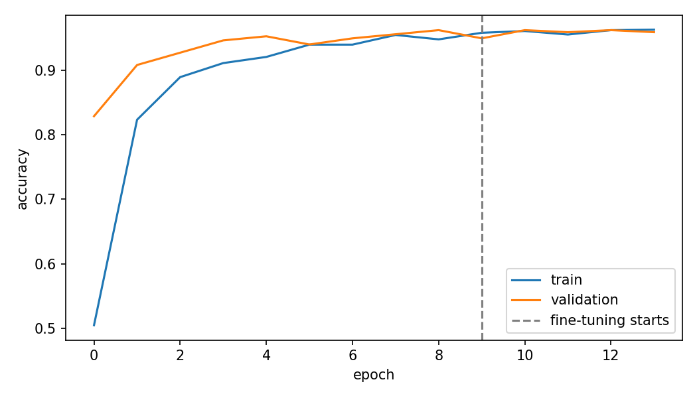
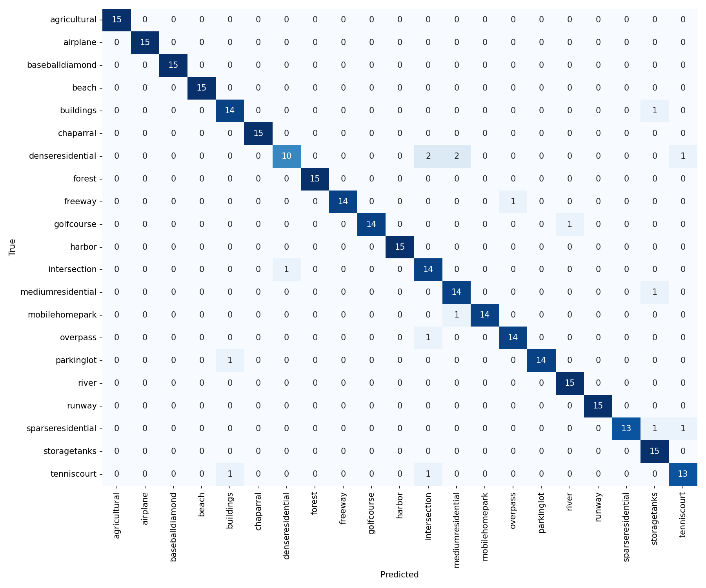

# Land Use Classification (UC Merced, 21 classes)

Classifies aerial imagery into 21 land-use categories (agricultural, forest, freeway, river,
tennis court, ...) for urban planning, environmental monitoring and resource management.

**Dataset:** UC Merced Land Use, 2,100 RGB images, 100 per class.

## Approach
- Stratified 70/15/15 train/validation/test split.
- Transfer learning with EfficientNetV2-B0 (ImageNet weights).
- Phase 1: train the classifier head on a frozen backbone. Phase 2: fine-tune the top 60 layers at a low learning rate.
- Augmentation: random flips and rotations, since aerial images have no fixed orientation.

## Results
Test accuracy: about 95% on 315 held-out images.

Most errors are between visually similar classes, mainly dense vs. medium residential and
buildings. See `classification_report.txt` for per-class scores.

## Run it
Open `Land_Use_Classification.ipynb` in Google Colab with a T4 GPU and run all cells.
